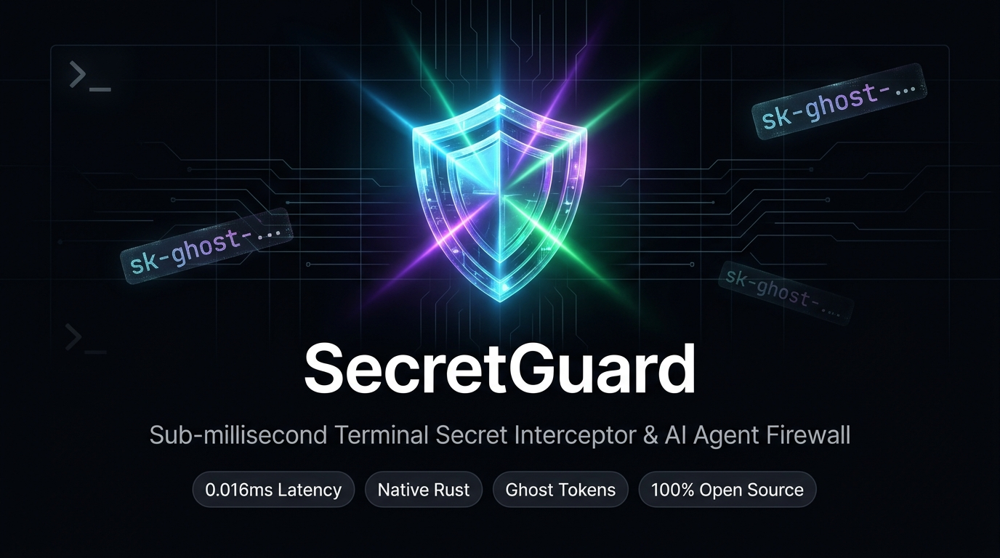

<div align="center">

# 🛡️ SecretGuard

**Local-First Terminal Secret Interceptor, Encrypted Vault, and AI Agent Guard in Rust**

[](https://crates.io/crates/secretguard)
[](https://github.com/hemanathk636/secretguard/releases)
[](https://hemanathk636.github.io/secretguard/)
[](https://github.com/hemanathk636/secretguard/actions)
[](LICENSE-MIT)

*Intercepts command buffers and child output streams in real time, preventing API keys, tokens, and database credentials from leaking into shell history, screen shares, or AI coding agent logs.*

<br/>

<br/>

<br/>

<br/>

</div>

---

## Overview

Most secret scanners run at `git commit` or in CI—**after** a credential has already been written to `~/.zsh_history` / `~/.bash_history`, displayed during a screen share, or read by a terminal AI coding agent.

SecretGuard adds a local, defense-in-depth layer across three pillars:

1. **Runtime Shield (`shield`)** — Shell pre-exec hooks (`zsh`, `bash`, `fish`, `nushell`, `powershell`), real-time output masking (`wrap`), clipboard auto-clear, and Ghost Token virtualization (`ghost`) to keep raw secrets out of LLM prompt context.
2. **Encrypted Vault & Broker (`vault`)** — AES-256-GCM + Argon2id local keystore (`~/.secretguard/`), in-memory secret injection (`vault run`), serverless P2P team sharing (`mesh`), and an authenticated local Security Broker with policy enforcement and tamper-evident HMAC audit logs.
3. **Auditing & Containment (`audit`)** — Repository/Git-history scanning (`scan`, `audit git`), Trojan Source / BiDi detection (`radar`), and incident containment (`immune`, `panic`) that quarantines keys locally first and optionally checks/revokes supported upstream provider APIs.

```text
                              ┌───────────────────────────────────────┐
                              │          secretguard CLI              │
                              │   (init / doctor / --version / help)  │
                              └───────────────────┬───────────────────┘
                                                  │
            ┌─────────────────────────────────────┼─────────────────────────────────────┐
            ▼                                     ▼                                     ▼
┌───────────────────────┐             ┌───────────────────────┐             ┌───────────────────────┐
│   PILLAR 1: SHIELD    │             │   PILLAR 2: VAULT     │             │   PILLAR 3: AUDIT     │
│   (Runtime Defense)   │             │  (Storage & Broker)   │             │  (Scan & Containment) │
└───────────┬───────────┘             └───────────┬───────────┘             └───────────┬───────────┘
            │                                     │                                     │
  ├─ hook (zsh/bash/fish/             ├─ init / set / run                       ├─ scan (files & repos)
  │  nushell/powershell)              │  (AES-256-GCM + HKDF +                  │  (patterns.rs + entropy.rs)
  │  └─ pre-exec redaction            │   O_NOFOLLOW / Win32 lock)              │
  │                                   │                                         ├─ audit git (timemachine.rs)
  ├─ wrap (stdout masking)            ├─ mesh (mesh.rs)                         │  └─ git log --all scan
  │  └─ StreamSanitizer               │  └─ Argon2id P2P vault                  │
  │                                   │                                         ├─ radar (radar.rs)
  ├─ ghost (ghost.rs)                 ├─ ipc / mcp / broker                     │  └─ Trojan Source / BiDi
  │  └─ decoy tokens in .env          │  (ipc.rs, mcp.rs, broker.rs,            │
  │                                   │   policy.rs, identity.rs)               ├─ immune / panic
  ├─ tun (swapper.rs)                 │  └─ kernel PID + bounded pool           │  (immune.rs, panic.rs,
  │  └─ local swapper testbed         │     + SSRF/userinfo defense             │   lifecycle.rs)
  │                                   │                                         │  └─ local quarantine +
  ├─ firewall (firewall.rs)           └─ canary (canary.rs)                     │     optional upstream API
  │  └─ agent command gate               └─ honeytoken tripwires                │
  │                                                                             └─ audit-ledger (audit.rs)
  └─ clipboard (clipboard.rs)                                                      └─ HMAC-SHA256 hash chain
     └─ auto-clear timer
```

> **Privacy & Network Boundary:** Core scanning, shell line interception, local vault encryption, Ghost Token generation, and audit logging run **100% offline with zero telemetry**. Outbound HTTPS requests occur **only** when explicitly invoked for upstream provider revocation/status verification (`immune` / `panic`), delegated broker HTTP calls, or installer provenance verification.

---

## Quick Install

### Precompiled Binaries (Recommended)
Download the archive and `.sha256` checksum for your platform from [**GitHub Releases**](https://github.com/hemanathk636/secretguard/releases/latest):
- **macOS (Apple Silicon):** `secretguard-aarch64-apple-darwin.tar.gz`
- **macOS (Intel):** `secretguard-x86_64-apple-darwin.tar.gz`
- **Linux (`x86_64`):** `secretguard-x86_64-unknown-linux-gnu.tar.gz`
- **Windows (`x86_64`):** `secretguard-x86_64-pc-windows-msvc.zip`

### One-Line Installer (macOS / Linux)
Requires `gh` (GitHub CLI) for mandatory Sigstore/SLSA build provenance verification (or an explicitly pinned `SECRETGUARD_MINISIGN_PUBKEY`):
```bash
curl -fsSL https://raw.githubusercontent.com/hemanathk636/secretguard/main/install.sh | bash
```

### Cargo (Rust)
```bash
cargo install secretguard
```

### Verify Release Integrity & Authenticity
Verify both the SHA-256 checksum (download integrity) and the Sigstore/SLSA provenance attestation (build authenticity):
```bash
# 1. Integrity
sha256sum -c secretguard-<TARGET>.tar.gz.sha256   # or: shasum -a 256 -c ...

# 2. Authenticity & SLSA provenance
gh attestation verify secretguard-<TARGET>.tar.gz \
  --repo hemanathk636/secretguard \
  --signer-workflow hemanathk636/secretguard/.github/workflows/release.yml \
  --source-ref refs/tags/v1.0.0 \
  --deny-self-hosted-runners
```
See [SECURITY.md](SECURITY.md) for Windows PowerShell verification commands.

---

## Quickstart

### 1. Initialize Workstation Hooks & Vault
```bash
secretguard init
secretguard doctor
```

### 2. Scan a Repository or Git History
```bash
secretguard scan .
secretguard audit git scan
```

### 3. Store & Inject Secrets in Memory (`vault`)
```bash
# Prompts securely with terminal echo disabled
secretguard vault init
secretguard vault set OPENAI_API_KEY
secretguard vault run -- python app.py
```

### 4. Mask Live Output (`wrap`)
```bash
secretguard wrap npm run dev
secretguard wrap docker compose logs
```

### 5. Air-Gap AI Agent Context (`ghost`) & Containment (`immune`)
```bash
# Replace credentials in .env with format-preserving decoy tokens for AI tools
secretguard ghost virtualize .env
secretguard ghost inspect
secretguard ghost purge

# Quarantine a leaked key locally and optionally verify/revoke upstream
secretguard immune contain "sk-proj-<COMPROMISED_KEY>"
```

---

## Shell Integration

| Shell | Configuration |
| :--- | :--- |
| **Zsh** (`~/.zshrc`) | `eval "$(secretguard hook zsh)"` |
| **Bash** (`~/.bashrc`) | `eval "$(secretguard hook bash)"` |
| **Fish** (`~/.config/fish/config.fish`) | `secretguard hook fish \| source` |
| **NuShell** (`~/.config/nushell/config.nu`) | `secretguard hook nushell` |
| **PowerShell** (`$PROFILE`) | `secretguard hook powershell \| Out-String \| Invoke-Expression` |

---

## Supported Secret Signatures

- **AI Providers:** OpenAI (`sk-proj-*`, legacy `sk-*`), Anthropic (`sk-ant-api03-*`), HuggingFace (`hf_*`), Google Gemini (`AIza*`).
- **Cloud & Messaging:** AWS (`AKIA*`, `ABIA*`, `ACCA*`, `ASIA*`), GCP, Slack tokens (`xoxb-*`, `xoxp-*`) and webhooks.
- **Auth & Payments:** GitHub (`ghp_*`, `gho_*`, `ghu_*`, `ghs_*`, `ghr_*`), Stripe (`sk_live_*`, `rk_live_*`), Postman (`PMAK-*`), SendGrid (`SG.*`).
- **Databases & Unstructured Secrets:** Connection URIs (`postgres://`, `mongodb://`, `mysql://`, `redis://`) with embedded credentials, PEM private key blocks, and high-entropy strings via contextual Shannon entropy ($H \ge 3.6$).

---

## Security Model & Known Limitations

- **Threat Model & Trust Boundaries:** See [SECURITY.md](SECURITY.md) for what SecretGuard defends against (accidental shell/git/LLM leaks, SSRF, URL `@` userinfo spoofing, symlink/TOCTOU races, untrusted IPC callers) and what is out of scope (root/administrator compromise or same-UID kernel debugging).
- **Defense-in-Depth:** SecretGuard reduces accidental exposure; it does not guarantee detection or prevention of every credential format or attack vector.

---

## Synthetic Benchmark Results

Measured across a **synthetic test suite of 1,000 commands** (500 synthetic credential samples + 500 clean commands) on optimized release builds:

| Metric | Synthetic Result | Target |
| :--- | :--- | :--- |
| **Synthetic Recall** | **100.0%** (500/500) | > 99.0% |
| **Synthetic False Positive Rate** | **0.0%** (0/500) | < 0.1% |
| **Average Scan Latency** | **15.68 µs** (0.016 ms) | < 1,000 µs (1.0 ms) |
| **Memory Footprint** | **~1.5 MB** | < 20 MB |

*> **Disclaimer:** Synthetic benchmark results do **not** guarantee 100% recall or 0% false positives on arbitrary real-world repositories, custom secret formats, or obfuscated inputs.*

---

## Release Notes

### `v1.0.0` (Current Release)
- Cross-platform CI (`ubuntu-latest`, `macos-latest`, `windows-latest`) with automated binary builds and Sigstore/SLSA provenance.
- Descriptor-relative `openat(..., O_NOFOLLOW)` traversal on Unix (including variadic C ABI fix for Apple Silicon `aarch64-apple-darwin`) and Windows ancestor directory handle anchoring.
- Authenticated local Security Broker & IPC with bounded worker pools, 64 KiB request limits, 5s I/O timeouts, and kernel peer PID verification.
- Immutable Git-object release packaging with full-block PEM and SHA-256 fixture verification.

For earlier `v0.3.x` release history, see [GitHub Releases](https://github.com/hemanathk636/secretguard/releases).

---

## License

Dual-licensed under either of:
- Apache License, Version 2.0 ([LICENSE-APACHE](LICENSE-APACHE) or http://www.apache.org/licenses/LICENSE-2.0)
- MIT license ([LICENSE-MIT](LICENSE-MIT) or http://opensource.org/licenses/MIT)
